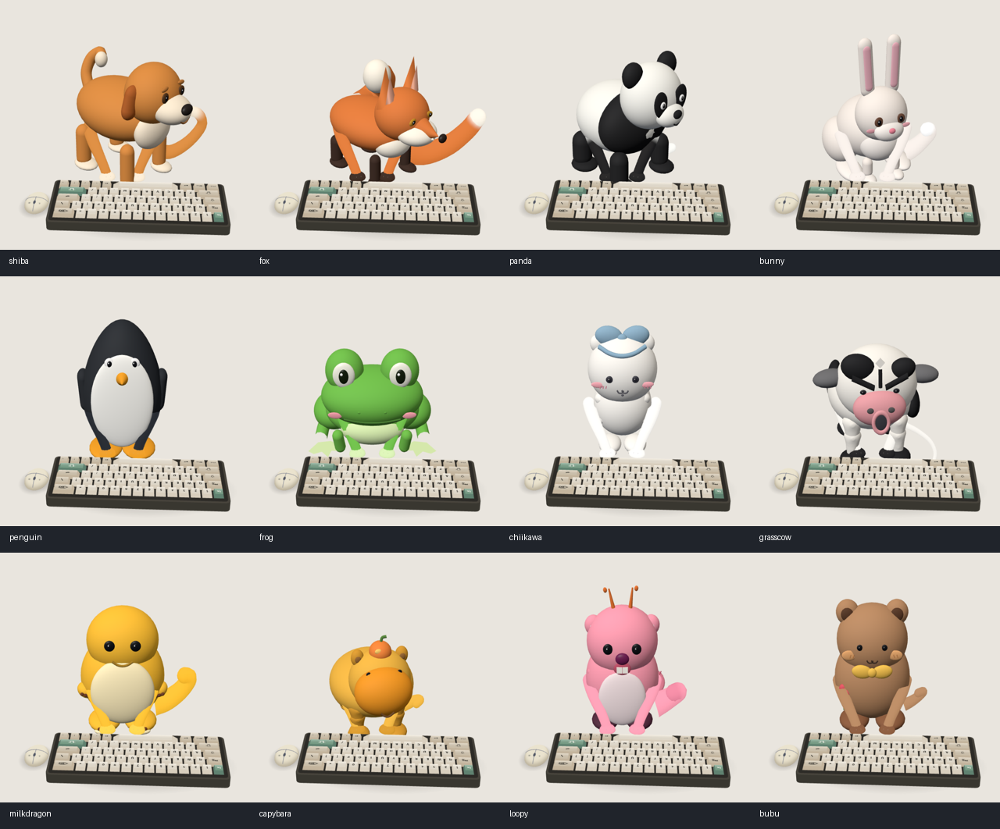

<div align="center">
  <h1>DesktopPet</h1>
  <p>
    <strong>A customizable 3D / 2D transparent desktop pet &amp; AI coding companion</strong><br />
    <sub>13 independently modelled animals · feeding &amp; care · OBS chroma-free source · MCP pet crafting · three keyboard themes</sub>
  </p>
  <p></p>
  <p>
    
    
    
  </p>
</div>

## What is it

DesktopPet stays on your desktop, reacts to your keyboard and mouse, lets you switch between 13 independently modelled animals, and needs regular care — feed it, give it water, play, or give it a bath. It reminds you when a need becomes urgent, with a one-click action. An MCP server is built in so AI agents can craft custom pets for you.

This is a community fork of [qianyiai/KuroCat](https://github.com/qianyiai/KuroCat) (MIT). It reworks the species modelling system, visual branding, keyboard themes and care gameplay into an independent product at version `1.0.0`. The original MIT copyright notice is preserved in [`LICENSE`](./LICENSE).

> ⚠️ This is **not** an official KuroCat release and is not affiliated with `kurocat.org` or the original author.

## Highlights

- **13 independent species** — cat, dog, fox, panda, bunny, penguin, frog, plus six community IP pets (Chiikawa, Grass Cow, Milk Dragon, Capybara, Loopy, Bubu). Non-cat species use their own geometry (including Blender 5.3 organic limb meshes), not recoloured cats.
- **2D / 3D engines** — switch freely; the six IP pets have their own expressions and motions.
- **Desktop care** — four actions across five needs, click the pet for a quick-action card, urgent needs trigger a reminder with one-click resolution.
- **Three keyboard themes** — oat / mist / clay, applied to keycaps, case and mouse.
- **AI companion** — agent status sync, typing reactions, OBS transparent source, MCP pet crafting, inherited from upstream.
- **Lightweight** — Tauri v2 + Rust; Windows installer about 2.4 MB.

## Get started

Grab an installer from [Releases](../../releases), or build from source:

```bash
npm install
npm run build
npx tauri build --bundles nsis
```

For local development, run `npx tauri dev`.

Settings are stored under `%APPDATA%\desktop-pet`. See [`动物桌宠使用说明.md`](./动物桌宠使用说明.md) (Chinese) for the full user guide.

## Credits

- Based on [qianyiai/KuroCat](https://github.com/qianyiai/KuroCat) under the [MIT License](./LICENSE).
- The whale-fish asset follows the upstream MIT attribution to [PC2005-cloud/dsh-pet](https://github.com/PC2005-cloud/dsh-pet).
- The six IP pet designs are community fan art; names and characters belong to their respective rights holders. Non-commercial use only.
