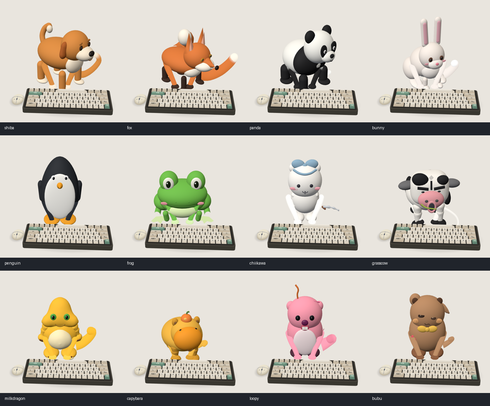

<div align="center">
  <h1>DesktopPet</h1>
  <p>
    <strong>可自由换装的 3D / 2D 透明桌面宠物 &amp; AI 编程伴侣</strong><br />
    <sub>13 种独立建模动物 · 喂食喝水养成 · OBS 免抠像 · 内置 MCP 捏宠 · 三款键盘配色</sub>
  </p>
  <p></p>
  <p>
    
    
    
  </p>
</div>

## 这是什么

DesktopPet 是一个能常驻桌面的虚拟宠物：透明置顶、会跟随你的键盘鼠标做动作、可以切换 13 种**独立建模**的动物、能喂食/喝水/玩耍/洗澡，状态缺了还会主动提醒你。还有一个给 AI 用的 MCP 接口，能让 AI 直接捏一只新宠物出来。

本项目是 [qianyiai/KuroCat](https://github.com/qianyiai/KuroCat)（MIT）的二次开发版本。在原版桌面打字猫/AI 伴侣能力之上，重做了物种建模系统、品牌视觉、键盘配色和养成玩法，并重新设定为独立产品，当前版本 `1.0.3`。原作者版权声明按 MIT 要求完整保留在 [`LICENSE`](./LICENSE)。

> ⚠️ **渠道说明**：本项目是社区二次开发分支，**不是 KuroCat 官方版本**，与 `kurocat.org` 及原作者无关。任何以 KuroCat 官方名义分发的可执行文件都请自行核验来源。

## 特色

- **13 种独立建模动物**：猫/狗/狐狸/熊猫/兔子/企鹅/青蛙 + 吉伊卡哇/草地牛/奶龙/水豚噜噜/露比/一二布布。非猫物种完全独立建模（含 Blender 5.3 离线生成的有机肢体网格原型），不是给猫换色。
- **2D / 3D 双引擎**：两种画风随时切换；6 只 IP 萌宠有各自的专属表情和动作（含打字时的肢体反馈）。
- **桌面养成**：喂食、喝水、玩耍、洗澡四套动作，饥饿/口渴/心情/精力/清洁五维状态；点击桌宠弹出快捷操作卡片，状态告急时主动提醒并支持一键处理。
- **三款键盘配色**：燕麦奶油 / 雾蓝夜航 / 陶土暖阳，键帽、机壳、鼠标同步换色，可在菜单首屏切换。
- **AI 编程伴侣**：和原版一样支持 AI 代理状态联动、打字代打、OBS 透明源、MCP 自定义捏宠。
- **轻量**：Tauri v2 + Rust，Windows 安装包约 2.4 MB。

## 快速开始

### 直接用现成安装包

到本仓库 [Releases](../../releases) 下载 `DesktopPet-安装包.exe` 或 `DesktopPet-绿色版.exe`。源码仓库里也保留了一份历史构建产物在 `交付产物/`，但**以 Releases 为准**。

### 从源码构建

前置环境：Windows 10/11、Node.js 18+、Rust（rustup）。

```bash
npm install
npm run build
npx tauri build --bundles nsis     # 输出在 src-tauri/target/release/bundle/nsis/
```

本地调试：

```bash
npx tauri dev
```

## 使用提示

- 右键托盘或点击桌宠打开菜单/养成卡片；点击宠物身上的不同部位有不同反应。
- 键盘配色在菜单「外观」页首屏切换；快捷键和详细玩法见 [`动物桌宠使用说明.md`](./动物桌宠使用说明.md)。
- 数据保存在 `%APPDATA%\desktop-pet`。
- 换账号或换电脑怎么接着干：见 [`继续执行指南.md`](./继续执行指南.md)。

## 开发者地图

| 路径 | 内容 |
| --- | --- |
| `src/speciesModel3d.ts` | 非猫物种 3D 建模与专属动作 |
| `src/blenderMeshes.ts` / `blenderMeshes.json` | Blender 网格原型运行时桥接 |
| `src/speciesRenderer2d.ts` | 非猫物种 2D 绘制与表情 |
| `src/petCare.ts` | 养成状态机、待办与提醒 |
| `src/keyboard3d.ts` / `keyboardLayout.ts` | 三款键盘主题 |
| `src/desktopPetTheme.css` | DesktopPet 品牌视觉 |
| `src-tauri/src/` | Rust 后端：设置持久化、透明窗口命中检测、MCP |
| `tools/` | 动物工坊、模型预览、截图验收脚本 |

## 致谢与许可

- 基于 [qianyiai/KuroCat](https://github.com/qianyiai/KuroCat) 二次开发，遵循 [MIT License](./LICENSE)。
- 大肥鱼（鲸鱼娘）素材沿用上游对 [PC2005-cloud/dsh-pet](https://github.com/PC2005-cloud/dsh-pet) 的 MIT 引用，详见 `src/assets/dafeiyu/LICENSE-MIT.txt`。
- 6 只 IP 萌宠为社区二创造型，相关名称与形象版权归各自权利人所有；本项目仅作非商业学习与桌面装饰用途。
